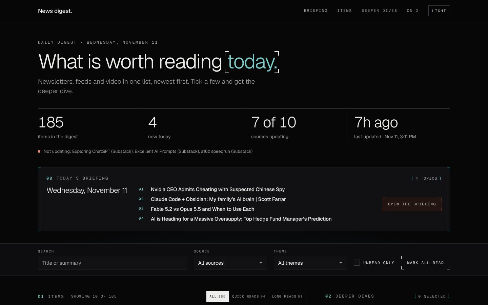
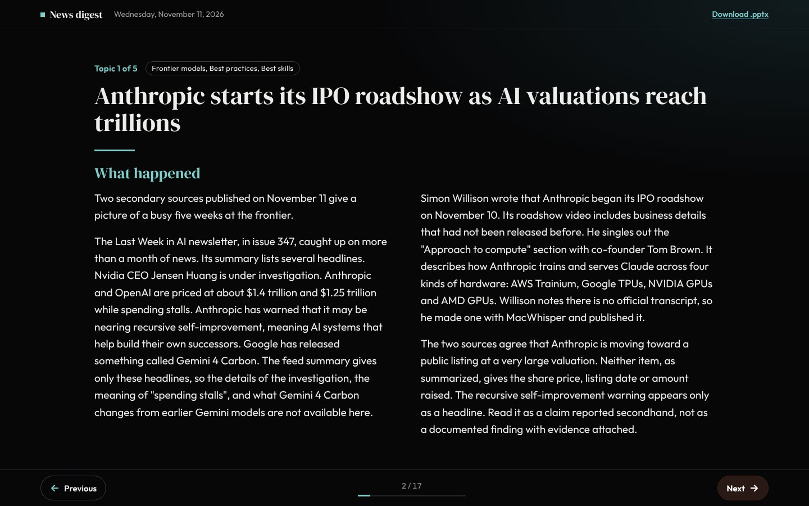
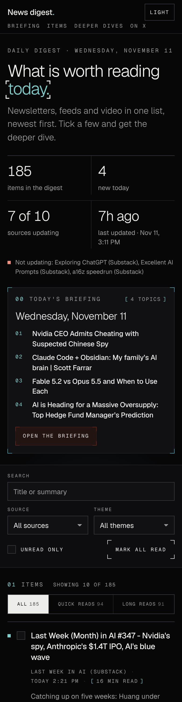
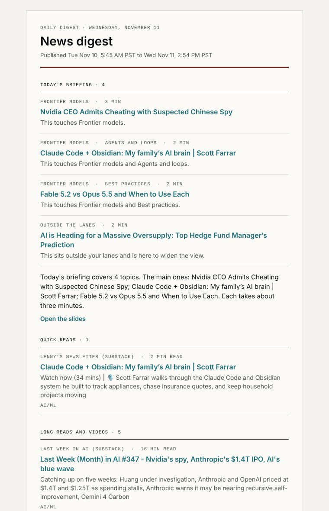

# News digest

A personal news dashboard that runs itself. It pulls newsletters, YouTube channels and websites into one searchable page, writes a short learning briefing every morning, and emails both before 6:00 AM.

**Live:** https://syb-code.github.io/news-digest/

This is a template repository. Click **Use this template** to get your own copy, then follow [Run your own](#run-your-own). A copy runs nothing until you turn it on.



| Learning briefing | Phone | Morning email |
|---|---|---|
|  |  |  |

## What it does

- **One list for everything.** Newsletters (RSS), YouTube channels and websites, newest first. The page opens on the 10 newest items; search and filters reach the rest.
- **A learning briefing every morning.** Three to five topics on what is new and important in AI, as a slideshow in the dashboard and a PowerPoint file. Each topic says what happened, why it matters, what to read first and one open question.
- **Ranked by importance, not by you.** Topics are picked by code from four signals: how many sources cover the story, whether a primary source published it, whether it is new since last week, and whether it fits a lane you watch. Nothing tracks clicks or reading time. One topic always comes from outside your lanes.
- **AI summaries on demand.** Tick items and click Summarize. A Cloudflare Worker reads each article or video and returns the key points.
- **Edit the X accounts from the dashboard.** With your key set, the On X panel gets an Add account form and a Remove button on each account. Visitors do not get them, and the Worker refuses an edit without the key.
- **A morning email.** The briefing first, then everything published since the last email.
- **A private stock section, for you only.** With your key set, the dashboard shows a Stocks section: a market overview and one analysis per ticker of your own list, with levels to watch and a track record that each ticker builds on its own. Nobody else sees it, and none of it is in the repository, the logs or the published site. See [Private stock analysis](#private-stock-analysis).

## How a day runs

| Time (America/Los_Angeles) | What happens |
|---|---|
| 5:45 AM | The morning run: refresh every feed, pick the topics, write the briefing with Claude, build the slides, publish the dashboard, send the email. |
| 12:00 PM | The noon run: refresh the feeds and publish the dashboard, so the morning's articles are there by lunch. |
| 5:45 AM, NYSE trading days | The stock run, if you set it up: read the market and your tickers, update what each ticker has learned, ask Claude for the assessments and save everything in the Worker. On weekends and NYSE holidays it stops at its first step. |

A Cloudflare cron trigger starts the runs (`worker/scheduler.js`, and `worker/stocks.js` for the stock run). GitHub's own scheduler can start a job hours late, which a 6:00 AM email cannot afford.

**Daylight saving.** Cloudflare cron runs in UTC, and Los Angeles is 7 hours behind UTC in summer and 8 in winter. So each local time has a cron expression that fires at both UTC hours, and the Worker starts a run only when the local clock reads exactly 5:45 or 12:00. That gives one run per time, every day, including the days the clocks change.

## How it is built

| Part | What it is |
|---|---|
| `config.yml` | The one file a copier edits: feeds, themes, time zone, and the briefing's model and limits. |
| `learn/lanes.md` | The areas the briefing watches, with keywords and sources. `learn/seen.json` logs past topics so one is not repeated without a new development. |
| `scripts/fetch_and_build.py` | Fetches every feed with timeouts and a time budget per source, and writes `docs/data/items.json`. A feed that fails keeps its last good items. |
| `scripts/learn/` | `candidates.py` groups and ranks the day's stories. `brief.py` asks Claude to write the topics. `render.py` builds the PowerPoint file and the dated folder. |
| `scripts/send_email.py` | The morning email, built with the Python standard library only. |
| `docs/` | The dashboard and the slideshow viewer: plain HTML, CSS and JavaScript on GitHub Pages, with self-hosted fonts. |
| `.github/workflows/daily.yml` | The morning and noon runs. |
| `worker/` | Blocks to paste into your Cloudflare Worker: `auth-guard.js` (the lock), `scheduler.js` (the clock), `sources.js` (add and remove X accounts from the dashboard) and `stocks.js` (the private stock section). `worker.js` is all four in one file, for a Worker with no summaries code of its own. |
| `scripts/stocks/` | The private stock run: data from public sources (`data/`), indicators and the per ticker learner (`analysis/`), Claude (`claude.py`) and the phases of the run (`run.py`). Standard library only, apart from the Anthropic SDK. |
| `.github/workflows/stocks.yml` | The stock run. Started by the Worker at 5:45 AM and by "Run analysis now". |
| `.github/workflows/sources.yml` | Adds or removes one X account in `data/x_accounts.json`, then starts a noon run to publish it. Started by the Worker when the owner edits the list. |
| `data/x_accounts.json` | The X accounts on the dashboard. Without it, `feeds.twitter_embeds` in `config.yml` is used. |
| `tests/` | Offline tests: `python3 -m unittest discover -s tests`. |

## The learning briefing

`candidates.py` takes the last 36 hours of items plus the sources in `learn/lanes.md`, groups stories that cover the same thing, and scores each group from the four signals. The weights are one table at the top of that file. It then picks the top three to five, always keeping the best story from outside your lanes.

`brief.py` sends only those picked stories to Claude and asks for a fixed JSON shape. Every link in the answer must be one of the links it was given, so the model cannot invent a source. If the key is missing or the call fails, the briefing is built from the headlines and the run still succeeds.

**What a day costs.** One Claude call per day, on `claude-opus-5-5` at medium effort:

| | Tokens | Cost |
|---|---|---|
| A typical day | about 6,000 in, 5,500 out | about $0.13 |
| The cap (`max_input_chars`, `max_output_tokens` in `config.yml`) | about 12,000 in, 12,000 out | about $0.30 |

That is about $4 a month. In the rare case that the model declines and a fallback model answers, the run can cost up to twice the cap. Every run logs its token counts and cost, and the last slide of each briefing shows the model and the cost. To spend less, set `model` to a smaller Claude model in `config.yml`.

## Private stock analysis

A section of the dashboard that only the holder of the Worker's access key sees. It is off until you set it up (step 8 of [Run your own](#run-your-own)).

**What it shows.**

- **Market first.** Upcoming catalysts (FOMC meetings with their press conference and projections flags, CPI, the jobs report, PPI, JOLTS, GDP and PCE), a macro table (the fed funds range, the 2 and 10 year yields and their spread, CPI and core CPI, core PCE, unemployment, payrolls, real GDP growth, VIX, the dollar, oil, the high yield spread, 5 year breakeven inflation and jobless claims), macro news from the Federal Reserve, BLS, BEA and the digest's Macro/Fed items, and a short summary by Claude of what matters this week.
- **One tab per ticker.** A price chart with the 20, 50 and 200 day averages, volume and RSI. Technicals (EMA, MACD, Bollinger bands, ATR, the 52 week range, relative strength against SPY, support and resistance). Trailing P/E from SEC filings (IFRS filers too; "not meaningful" when earnings are negative). FINRA short sale volume judged against that stock's own history, and short interest. Insider trades (Form 4), quarter over quarter changes of 16 well known funds (13F), and trades of members of Congress (House reports, best effort). How the stock has moved with yields, the dollar, oil, VIX, and on past FOMC and CPI days. Then Claude's assessment: a stance, entry zones, targets and a stop. Every price must be one of the levels the code computed; anything else is dropped and the code's own levels are used instead. Not financial advice.
- **A track record per ticker.** Each ticker has its own small model, prediction log, graded results, scorecard (hit rate, Brier score against the base rate, calibration) and a short list of lessons. On its first day it is trained on that stock's own history, walking forward; then every trading day it logs a call, grades the calls whose time has come, and refits. Claude sees that ticker's record and lessons and nothing of any other ticker. A ticker with a short history (a recent listing) says so and starts from the base rate.

**Where the data lives.** Your ticker list, the settings, every analysis and what each ticker has learned live only in the Worker's KV namespace `STOCKS_KV`. The workflow reads the list from the Worker, works in a private temporary folder on the runner that is deleted at the end, and sends the results back to the Worker. The log shows counts, durations and costs only: each ticker is registered with GitHub's `::add-mask::` before anything is printed, as a backstop. Nothing of it is committed, uploaded as an artifact, cached or published. The only artifact of the stock workflow is the public list of every House member's trades. It holds all of them, so it can include stocks you track, but it is never filtered to your tickers and does not show which ones you follow.

**Data sources.** Prices from Tiingo (a free key). Filings from SEC EDGAR, short data from FINRA, macro series from FRED, calendars and news from the Federal Reserve, BLS and BEA, all without a key. Senate trades only with an optional Financial Modeling Prep key.

**Model and cost.** The default is `claude-sonnet-5-5`; you can switch between `claude-opus-5-5`, `claude-sonnet-5-5` and `claude-haiku-5-5` on the dashboard. One call per ticker and one for the overview, each checked in code. With Sonnet and eight tickers a trading day costs about $0.55 to $0.80 (about $12 to $17 a month); Opus about twice that, Haiku about a twentieth. A run stops asking Claude once its worst case would pass `stocks.max_run_usd` in `config.yml` ($3.00); the tickers it skips keep the code's levels. Prices and limits are in the `stocks` section of `config.yml`, which never holds a ticker.

## Security design

The repository and the page are public, so everything is built on the assumption that anyone can read the code. No key, token, email address or private address is in any file.

| Secret | Where it lives | Who can use it |
|---|---|---|
| `ANTHROPIC_API_KEY` | GitHub environment `digest` (main only) | Only the step that calls Claude |
| Gmail client id, secret, refresh token, sender, recipient | GitHub environment `digest` (main only) | Only the step that sends the email |
| AI keys for summaries, `ACCESS_KEY`, `GH_DISPATCH_TOKEN` | Cloudflare Worker secrets | Only the Worker |
| The Worker's address | GitHub repository variable `WORKER_URL` | Written into the published site only |
| `TIINGO_API_KEY`, `SEC_USER_AGENT`, `FMP_API_KEY` (optional) | GitHub environment `digest` (main only) | Only the step of the stock run that fetches the data |
| `STOCKS_INGEST_KEY` | GitHub environment `digest`, and a Cloudflare Worker secret with the same value | The two steps of the stock run that read from and save to the Worker, and the Worker's ingest routes |
| Your ticker list, settings and analyses | The Worker's KV namespace `STOCKS_KV` | The Worker, for the access key holder and the stock run |

- **Only the owner can change it.** Others can read and copy the code. They cannot push to it, and a fork or a copy gets none of the secrets or variables.
- **No workflow runs on pull requests**, and every job is off unless the variable `DIGEST_ENABLED` is `true`.
- **No third-party code runs next to a secret or a write token.** Feeds are fetched in a job with no secret. The Claude step installs only the Anthropic SDK. The commit job installs nothing and copies only checked files. The email runs on the standard library. Every package is pinned by hash.
- **Only the key holder edits the X accounts.** The dashboard sends the edit to the Worker, which checks the access key and then starts a workflow with a token that can start workflows and nothing else. The workflow checks the handle again, runs no third-party code, and is the only thing that writes the list.
- **The Worker is locked.** `worker/auth-guard.js` refuses any request without the access key, so visitors can browse the dashboard but only the owner can spend the AI budget.
- **Stock data stays private.** The ticker list is never in a file or a workflow input. The stock job masks every ticker before it prints anything, logs counts only, keeps its files in a private temporary folder and deletes it, and saves its results only in the Worker. The Worker's ingest routes take their own key, compared in constant time, and refuse browsers. Visitors of the dashboard get nothing of it: the section stays hidden without the key.
- **The pages load only their own files.** A strict Content-Security-Policy allows no inline script or style. Feed text and model text are always rendered as text, and only `https` links are kept.

## Run your own

About 30 minutes. You need a GitHub account, a Cloudflare account (free), a Claude API key and a Gmail account to send from.

1. **Copy it.** Click **Use this template**, then **Create a new repository**. Public is required for free GitHub Pages.
2. **Edit `config.yml`.** Put in your own feeds, themes and time zone. Edit `learn/lanes.md` for the areas you want to watch.
3. **Turn on Pages.** Settings > Pages > Source: **GitHub Actions**. Do not pick "Deploy from a branch".
4. **Create the secrets.** Settings > Environments > New environment, named `digest`. Under Deployment branches choose **Selected branches** and add `main`. Add these environment secrets:
   - `ANTHROPIC_API_KEY`, from the Claude Console. Set a monthly spend limit there.
   - `GMAIL_CLIENT_ID`, `GMAIL_CLIENT_SECRET`, `GMAIL_REFRESH_TOKEN`, `SENDER_EMAIL`, `RECIPIENT_EMAIL`. The steps for a send-only Gmail token are in `scripts/oauth_local_example.py`.
5. **Set up the Worker.** In Cloudflare, create a Worker for summaries, or skip summaries and use the Worker only as the clock.
   - No summaries code of your own: paste `worker/worker.js` as the whole Worker. It is the lock, the clock and the X account editor in one file. With your own summaries code: paste `worker/auth-guard.js`, `worker/scheduler.js` and `worker/sources.js` at the top of it and follow the steps at the top of each file.
   - Add the Worker secrets `ACCESS_KEY` and `GH_DISPATCH_TOKEN`, and the variables `GH_REPO` (`your-name/your-repo`) and `ALLOWED_ORIGINS` (`https://your-name.github.io`).
   - Add the two cron triggers listed in `scheduler.js`.
6. **Set the variables.** Settings > Secrets and variables > Actions > Variables:
   - `WORKER_URL`: your Worker's address, such as `https://name.your-subdomain.workers.dev`. Leave it out to turn summaries off.
   - `DIGEST_ENABLED`: `true`. This is the on switch, so set it last.
7. **Test it.** Actions > Daily digest > Run workflow > `morning`. When it finishes, open your site, click **Today's briefing**, and check your inbox. Then click **Set key** on the dashboard and paste your `ACCESS_KEY`. With the key set, the On X panel shows Add account and Remove. A change appears on the site a couple of minutes later.
8. **Optional: the private stock section.**
   - Get a free Tiingo key at tiingo.com. In the `digest` environment add the secrets `TIINGO_API_KEY`, and `SEC_USER_AGENT` with a name and an email address, such as `news-digest you@example.com` (SEC, BLS and FRED refuse requests without one). Optional: `FMP_API_KEY` for Senate trades.
   - Generate an ingest key with `openssl rand -base64 32`. Add it as the `digest` secret `STOCKS_INGEST_KEY` and, with the same value, as the Worker secret `STOCKS_INGEST_KEY`. It must not be your `ACCESS_KEY`.
   - In Cloudflare create a KV namespace (Storage & Databases > KV) and bind it to the Worker as `STOCKS_KV` (your Worker > Settings > Bindings).
   - Paste the new `worker/worker.js`, or `worker/stocks.js` below the other blocks with the last line from its header, and deploy.
   - Add the repository variable `STOCKS_ENABLED` with the value `true`.
   - On the dashboard, with your key set, open Stocks, add your tickers and click **Run analysis now**. The results appear about 15 minutes later. From then on the run starts by itself at 5:45 AM on NYSE trading days.

`.env.example` lists every setting by name, with empty values. Real values never go in a file. `.gitignore` only applies to `git add`, and uploading a folder on github.com commits everything in it, so keep credential files outside the project folder.

## Local development

```sh
pip install --require-hashes -r requirements-build.lock
pip install --require-hashes --no-build-isolation -r requirements.lock
python3 scripts/fetch_and_build.py
python3 scripts/learn/candidates.py --out /tmp/candidates.json
python3 scripts/learn/brief.py --candidates /tmp/candidates.json --out /tmp/briefing.json
python3 -m unittest discover -s tests
python3 -m http.server 8000 --bind 127.0.0.1 -d docs
```

Then open http://localhost:8000/. To try the stock run on your own machine, with the keys set in your shell, run `python3 -I scripts/stocks/run.py local --dir /tmp/stocks --tickers AAPL,MSFT --out ~/stocks-out` (both folders outside the repository; nothing is sent to a Worker). Without `ANTHROPIC_API_KEY` set, `brief.py` writes a briefing from the headlines, which is enough to try the rest. To call Claude locally, also run `pip install --require-hashes -r requirements-brief.lock`. To change dependencies, edit the `.in` files and regenerate the locks as described at the top of `requirements.in`.
